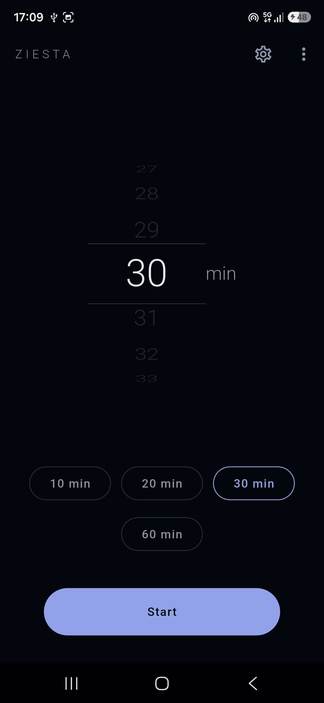
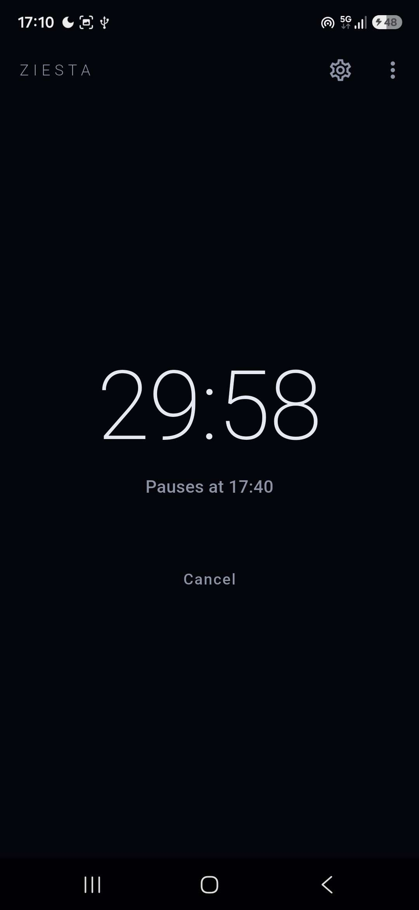
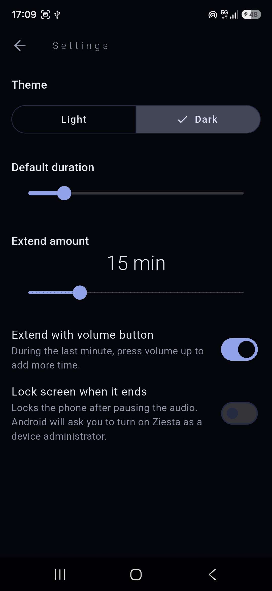
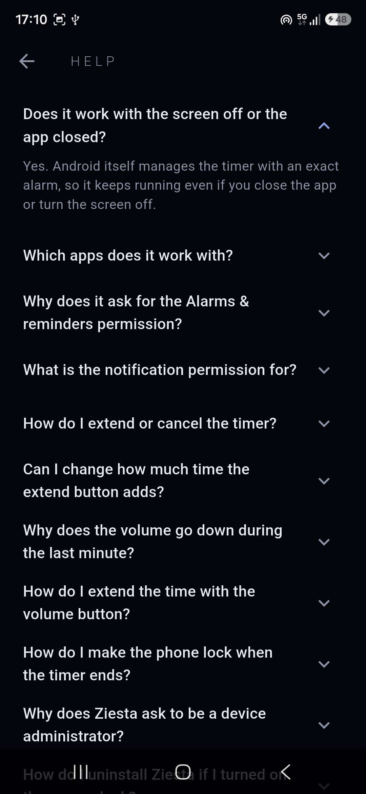

# Ziesta

A sleep timer for Android that **pauses the audio of other apps** (YouTube, Twitch...)
after the time you choose, so you never wake up with a video still playing.

<p align="center">
  
  
  
  
</p>

## Features

- Pick the time with a wheel (1-180 minutes) or one of the quick buttons: 10, 20, 30 and 60 minutes.
- Works with the screen off and with the app closed.
- Persistent, silent notification with a live countdown and **+N min** and **Cancel** buttons,
  so you can extend or stop the timer without opening the app.
- Configurable extend amount (1-60 minutes) in Settings.
- Gradual volume fade during the last minute; the original volume is restored after the pause.
- Optional: press volume up during the fade to extend the timer (on by default).
- Optional: lock the screen when the timer ends (off by default, needs the device administrator
  permission).
- Menu with **Share the app** and an in-app **FAQ**.
- Minimalist dark interface (light theme available), in Spanish and English.

## How it works

Flutter can't control other apps' audio by itself, so the project combines two layers:

- **Dart / Flutter**: UI, state (Riverpod), settings and storage (`shared_preferences`).
- **Kotlin (Android)**, reached through a `MethodChannel`:
  - `AlarmManager` schedules an exact alarm that fires even in Doze mode.
  - A `BroadcastReceiver` requests **audio focus** and sends a **media pause key event**,
    which makes players such as YouTube and Twitch pause.
  - A short foreground service lowers the media volume during the last minute and, if enabled,
    watches for volume-up presses to extend the timer.
  - An ongoing notification shows the countdown (drawn by the system, so it costs no battery)
    and handles the extend and cancel actions.
  - The optional screen lock uses the Device Administrator API with the `force-lock` policy only
    (`DevicePolicyManager.lockNow()`). It lives in its own files so it can be removed easily.

The native side owns the timer: it stores the end time and the timer-related settings, so the
notification buttons work even if the app is closed. The Flutter side only asks for that data
(once at startup and then every second while a countdown is visible), so the screen always
stays in sync.

## Install

Download the latest APK from the [Releases](../../releases) page and open it on your phone
(you may need to allow installing apps from your browser).

Requires Android 8.0 or newer. On first use, Ziesta asks for:

- **Alarms & reminders** (exact alarms), to pause at the right time.
- **Notifications**, to show the countdown.
- **Device administrator**, only if you turn on the screen lock option. It is used to lock the
  screen and nothing else.

## Build from source

```
flutter pub get
flutter gen-l10n
flutter run
```

Run the checks with `dart format .`, `flutter analyze` and `flutter test`.
To build a signed release you need your own keystore and an `android/key.properties` file
(not included in the repository).

## Project structure

```
lib/
  core/        shared code (native channel, preferences, theme, links)
  features/
    timer/     timer screen, state and countdown
    settings/  settings screen and state
    menu/      app menu and FAQ
  l10n/        translations (.arb)
android/app/src/main/kotlin/   alarm, audio, volume fade, notification and screen lock code
test/                          unit and widget tests
```

## Known limitations

- Restarting the phone cancels the pending alarm.
- Tested with the YouTube and Twitch apps; other players may ignore audio focus
  and media keys.
- The volume fade changes the system media volume and restores it afterwards.
- Extending with the volume button depends on how the device reports volume changes and may not
  work on every phone.
- While the screen lock option is on, Ziesta is a device administrator and Android will not let you
  uninstall it. Turn the option off in Settings first.
